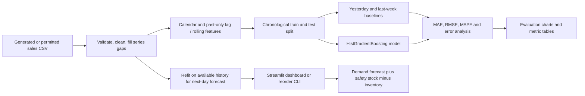
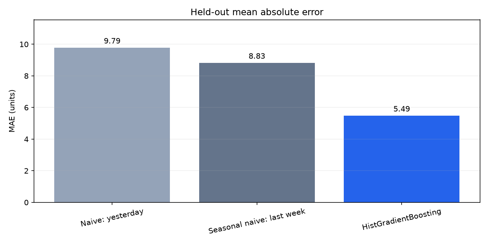
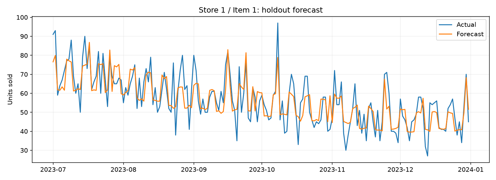
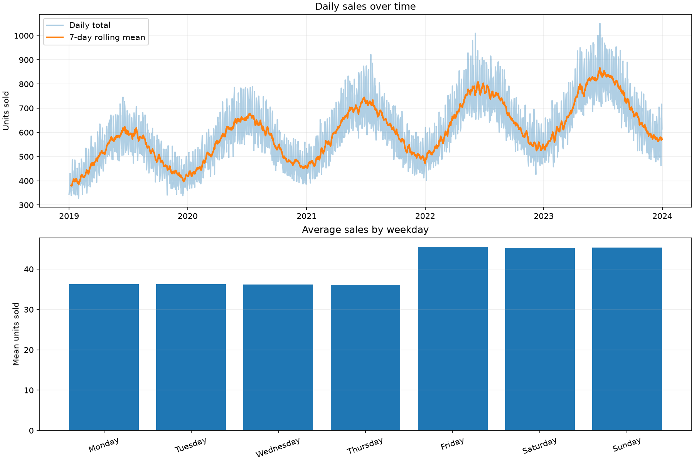

# Sales Forecast & Reorder Planner

Forecast daily demand for each store and item, compare a machine-learning model with simple time-series baselines, and turn the next-day forecast into an inventory reorder suggestion.

The project includes a Streamlit dashboard, command-line workflow, reproducible synthetic data, leakage-aware features, test-period evaluation, and visual reports.

## What it does

- Creates a reproducible, offline-ready sales dataset for 3 stores and 5 items.
- Validates records, aggregates duplicate store-item-date rows, and fills missing dates within each series.
- Builds calendar, lag, and shifted rolling-mean features using past observations.
- Uses a chronological holdout and compares yesterday, last-week, and HistGradientBoosting forecasts.
- Reports MAE, RMSE, and MAPE, plus forecast, weekday-error, and model-comparison charts.
- Suggests next-day reorder quantities based on predicted demand, current stock, promotion plans, and configurable safety stock.

## How the pipeline works



## Results

Measured with the included synthetic dataset on the held-out dates **2023-07-01 through 2023-12-31**. Evaluation is one-step rolling: the features for a test date may use observed sales from earlier test dates, as they would be available in a daily forecast workflow.

| Model | MAE ↓ | RMSE ↓ | MAPE ↓ |
|---|---:|---:|---:|
| Yesterday (naive) | 9.79 | 13.37 | 22.88% |
| Same weekday last week | 8.83 | 12.06 | 21.03% |
| HistGradientBoosting | **5.49** | **7.12** | **13.58%** |

On this synthetic holdout, the ML model reduces MAE by about **37.8%** versus the seasonal-naive baseline. The checked-in metrics and charts were regenerated with Python 3.14, pandas 3.0.1, and scikit-learn 1.8.0; scores can vary slightly with supported library versions.

### Model comparison



### Forecast versus actual



### Synthetic demand pattern



## Run locally

Requires Python 3.10 or newer.

### Windows PowerShell

```powershell
git clone https://github.com/Simaaqmoideen/sales-forecast-reorder-planner.git
cd sales-forecast-reorder-planner
python -m venv .venv
.venv\Scripts\Activate.ps1
python -m pip install -r requirements.txt
python src/generate_data.py
python src/eda.py
python src/baselines.py
python src/train.py
python src/evaluate.py
python -m pytest -q
streamlit run app.py
```

### macOS / Linux

```bash
git clone https://github.com/Simaaqmoideen/sales-forecast-reorder-planner.git
cd sales-forecast-reorder-planner
python3 -m venv .venv
source .venv/bin/activate
python -m pip install -r requirements.txt
python src/generate_data.py
python src/eda.py
python src/baselines.py
python src/train.py
python src/evaluate.py
python -m pytest -q
streamlit run app.py
```

The app opens locally in your browser. The data generator uses a fixed random seed, so generated sales are reproducible. Generated datasets, model files, and caches are excluded from Git; charts and measured metric tables are checked in for the README.

## Reorder from the command line

```bash
python src/recommend_reorder.py --store 1 --item 1 --on-hand 20
python src/recommend_reorder.py --store 1 --item 1 --on-hand 20 --promo --safety-factor 0.30
```

The first example forecasts the next day from all available sales history, then calculates the suggested units to order using the default 20% safety factor. The second example marks a promotion and uses 30% safety stock. You can also change store, item, and inventory in the Streamlit dashboard.

## Data and forecasting notes

- The default workflow is fully offline after dependencies are installed: `python src/generate_data.py` creates synthetic data from 2019-01-01 through 2023-12-31.
- The synthetic data includes trend, weekly and yearly seasonality, promotion flags, and random sales variation. It has no holiday labels; holiday effects are not modeled.
- Missing observations within a store-item series are interpreted as zero recorded sales. For real sources, confirm this assumption before applying the cleaning pipeline.
- The holdout ends on 2023-12-31. The next-day CLI example therefore forecasts 2024-01-01 for the included sample data; with newer history, it forecasts the day after the latest date.
- Reorder recommendations are planning suggestions, not guarantees. Lead times, supplier minimums, spoilage, service-level targets, and uncertainty intervals are outside this version.

## Repository guide

| Path | Contents |
|---|---|
| `app.py` | Streamlit presentation and interactive inventory controls |
| `src/data.py`, `src/features.py` | Validation, cleaning, and past-only feature construction |
| `src/baselines.py`, `src/train.py`, `src/evaluate.py` | Baselines, training, metrics, and reports |
| `src/forecast.py`, `src/reorder.py`, `src/recommend_reorder.py` | Next-day prediction and reorder calculation |
| `tests/` | Unit tests for cleaning, features, baselines, evaluation, and forecasts |
| `reports/` | Generated charts and metric CSVs displayed above |
| `docs/` | Project brief, requirements, architecture, data notes, roadmap, tests, risks, checklist, and final report |

## Tech stack

Python · pandas · NumPy · scikit-learn · Matplotlib · Streamlit · pytest

## License and source data

The included generator is the default data source. Optional external datasets are listed in [`docs/04_DATA.md`](docs/04_DATA.md); follow each source's license and terms before using or redistributing it. Add an appropriate repository license before publishing if you intend to grant reuse rights.
