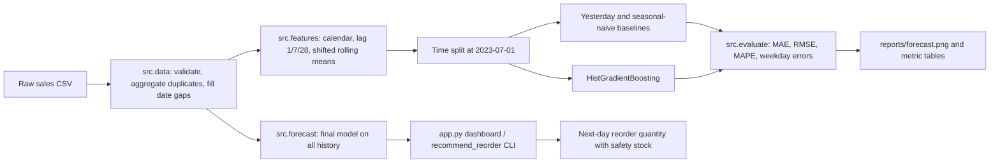

# Architecture: Sales Prediction Project

## Overview

## Tech stack
- Python 3.10+
- pandas, numpy
- scikit-learn (GradientBoosting / RandomForest)
- matplotlib
- statsmodels or prophet (optional)
- pytest

## Design decisions (fill in as you go)
| Decision | Options considered | Choice | Why |
|---|---|---|---|
| Evaluation split | Random, time-based | Train before 2023-07-01; test from that date to 2023-12-31 | Preserves chronology and avoids future leakage. |
| Baselines | Yesterday, same weekday last week | Report both | Yesterday is a simple reference; weekly seasonality is present in the generator. |
| Missing date handling | Drop, impute | Fill missing dates per series with zero sales and promo off | Explicit assumption for absent daily records in this demo. |
| Final next-day model | Use cutoff-trained artifact, refit on all history | Refit on all available history for future forecasts | The holdout metrics remain based on the earlier training-only model. |

## Module responsibilities
See the files in `src/`. Keep logic (testable functions) separate from UI and scripts.
